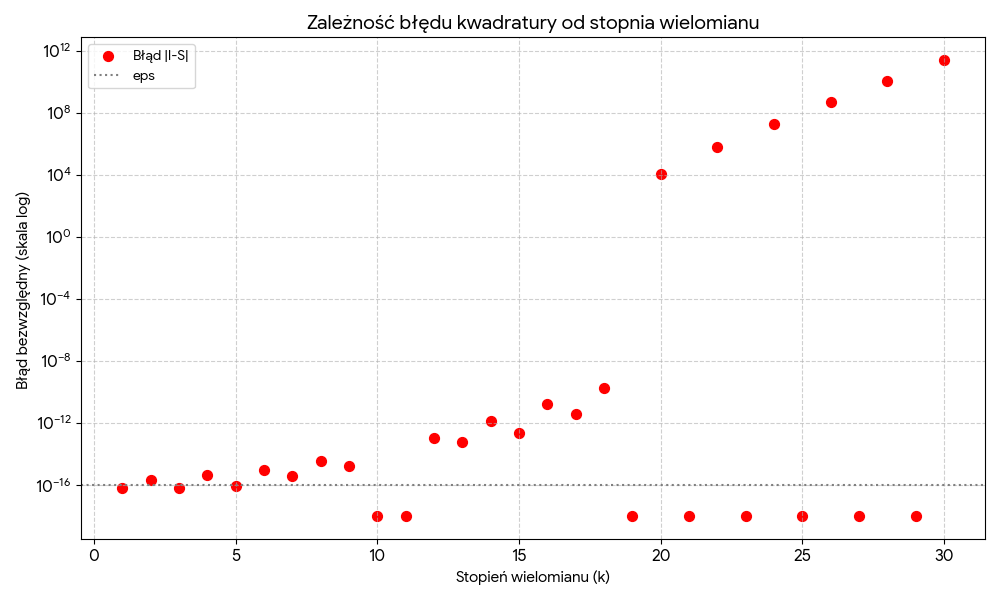
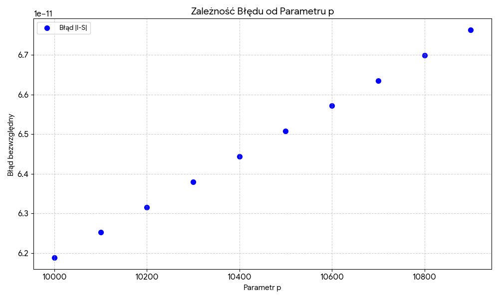

# Gauss-Hermite Quadrature for Double Integrals (MATLAB)

Computing double integrals using the **10-point Gauss-Hermite quadrature**
with respect to each variable.

## Problem statement

Computing integrals:

\,dx\,dy)

using the 10-point Gauss-Hermite quadrature with respect to each variable.

## Method description

To approximate integrals of the form ∫ e<sup>−x²</sup> f(x) dx over (−∞, ∞), we use
the Gauss-Hermite quadrature of order *n*:

\,dx\approx\sum_{i=1}^{n}A_i\,f(x_i))

where:

- xᵢ are the roots of the Hermite polynomial of degree *n*,
- Aᵢ are the quadrature weights,
- the Hermite polynomials satisfy the recurrence relation:

=1,\qquad%20H_1(x)=2x,\qquad%20H_k(x)=2xH_{k-1}(x)-2(k-1)H_{k-2}(x),\quad%20k=2,3,\dots)

For the double integral, we use the quadrature:

\,dx\,dy\approx\sum_{i=1}^{n}\sum_{j=1}^{n}C_{ij}\,f(x_i,y_j),\qquad%20C_{ij}=A_iB_j)

The weight matrix *C* is computed as the product of the weight vectors.


The nodes and weights for *n* = 10 are stored in the code as constants.

## Properties

- **Order of the quadrature.** A Gaussian quadrature based on *n*+1 nodes has order 2*n*+2.
  Therefore, the 10-node quadrature gives exact results for polynomials of degree
  less than 20.
- **Odd functions.** e<sup>−x²</sup> is an even function. If *f* is
  odd with respect to one of the variables, e.g. f(−x, y) = −f(x, y), then I(f) = 0,
  because one of the iterated integrals vanishes:
  =\int_{-\infty}^{\infty}e^{-y^2}\underbrace{\left[\int_{-\infty}^{\infty}e^{-x^2}f(x,y)\,dx\right]}_{=0}dy)

- **Error.** The error of a single (*n*+1)-point Gaussian quadrature is given by:

  -G_n(f)=\frac{f^{(2n%2B2)}(\xi)}{(2n%2B2)!}\int_{-\infty}^{\infty}e^{-x^2}\big(\varphi_{n%2B1}(x)\big)^2\,dx)

## Project structure

| File | Description |
|------|------|
| `P1Z49_JJA_Gauss_Hermit.m` | Main function – approximate value of the integral |
| `get_hermite_nodes.m` | 10 nodes – roots of H₁₀ |
| `get_hermite_weights.m` | 10 quadrature weights |
| `test1.m` | Test on functions with known integrals |
| `test2.m` | Edge case test |
| `numtest1.m` | Numerical experiment 1 – order of the quadrature |
| `numtest2.m` | Numerical experiment 2 – error analysis |

## Usage

```matlab
f = @(x,y) cos(x).*cos(y);
q = P1Z49_JJA_Gauss_Hermit(f)
```

If the function has a domain that prevents integration over ℝ²
(e.g. `log(x)`) or takes complex values, the function returns `NaN`.

## Correctness tests

### `test1` – functions with known integrals

| f(x, y) | I(f) | S(f) | \|I − S\| |
|---|---|---|---|
| cos x · cos y | 1.90547 | 1.90547 | 4.65·10⁻⁶ |
| sin x · sin² y | 0 | 5.27·10⁻¹⁸ | 5.27·10⁻¹⁸ |
| x² · sin² x · cos² y | 0.73478 | 5.70·10⁻³³ | 0.73478 |
| x² · y⁶ · cos x | 1.14688 | 1.14688 | 3.83·10⁻⁷ |
| x¹⁸ · y² | 1.05720·10⁵ | 1.05720·10⁵ | 3.27·10⁻¹ |
| x · eˣ | 2.01691 | 2.01694 | 2.75·10⁻⁵ |
| 1 | 3.14159 | 3.14159 | 0 |
| sin x · cos x | 0 | 5.19·10⁻¹⁷ | 5.19·10⁻¹⁷ |

## Numerical experiments

### `numtest1` – order of the quadrature

Integration of the polynomials f(x, y) = xᵏ. The exact value for *k* = 2*m* is
!!}{2^m}\pi),
and for odd *k*, I = 0.

| Polynomial | I(f) | S(f) | \|I − S\| |
|---|---|---|---|
| x¹ | 0 | 6.25·10⁻¹⁷ | 6.25·10⁻¹⁷ |
| x² | 1.57 | 1.57 | 2.22·10⁻¹⁶ |
| x¹⁰ | 9.28·10¹ | 9.28·10¹ | 0 |
| x¹⁸ | 2.11·10⁵ | 2.11·10⁵ | 1.75·10⁻¹⁰ |
| x¹⁹ | 0 | 0 | 0 |
| **x²⁰** | **2.01·10⁶** | **1.99·10⁶** | **1.11·10⁴** |
| x²² | 2.11·10⁷ | 2.05·10⁷ | 6.18·10⁵ |
| x³⁰ | 5.93·10¹¹ | 3.33·10¹¹ | 2.60·10¹¹ |



**Conclusion:** in line with theory, for polynomials of degree *k* ≥ 20 the error increases sharply.

### `numtest2` – dependence of the error on the 20th derivative

The tested function was
=e^{x\,p^{1/20}}),
whose 20th derivative equals p · f(x, y), i.e. it grows linearly with the parameter *p*.
Exact value:
.

| p | \|I(f) − S(f)\| | Difference of increments |
|---|---|---|
| 10000 | 6.19·10⁻¹¹ | – |
| 10100 | 6.25·10⁻¹¹ | 6.37·10⁻¹³ |
| 10200 | 6.32·10⁻¹¹ | 6.37·10⁻¹³ |
| 10300 | 6.38·10⁻¹¹ | 6.39·10⁻¹³ |
| 10400 | 6.44·10⁻¹¹ | 6.37·10⁻¹³ |
| 10500 | 6.51·10⁻¹¹ | 6.38·10⁻¹³ |
| 10600 | 6.57·10⁻¹¹ | 6.41·10⁻¹³ |
| 10700 | 6.63·10⁻¹¹ | 6.39·10⁻¹³ |
| 10800 | 6.70·10⁻¹¹ | 6.37·10⁻¹³ |
| 10900 | 6.76·10⁻¹¹ | 6.40·10⁻¹³ |



**Conclusion:** increasing the parameter *p* linearly increases the 20th derivative linearly,
which in turn increases the error linearly. The constant difference between successive increments confirms this relationship.

## Running the tests

```matlab
test1
test2
numtest1
numtest2
```

The tests print results in batches – once the console fills up, press any key.

## Author

Jakub Jaworski
